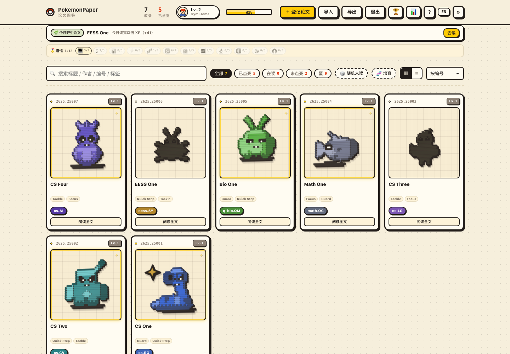
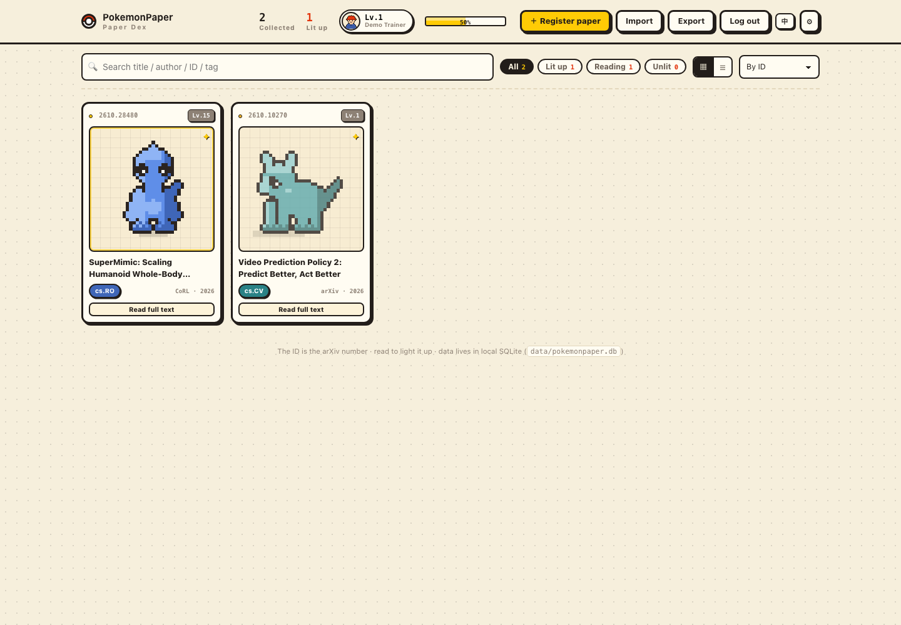

<div align="center">

# PokemonPaper

**Every paper becomes a Pokémon. Its number is the arXiv ID. Read it, and it lights up.**

[](https://vuejs.org/)
[](https://www.typescriptlang.org/)
[](https://nodejs.org/api/sqlite.html)
[](LICENSE)

[中文](README.md) · **English**

[Quick start](#quick-start) · [Design](#three-design-decisions) · [Structure](#project-structure) · [Roadmap](#roadmap)

</div>



---

## What it is

The hard part of reading papers isn't reading — it's **remembering what you've read**. PokemonPaper turns it into a collection game:

- Add a paper and it becomes a sprite
- Unread papers are grey silhouettes; reading ones are half-colored; finished ones **light up**
- The number is the arXiv ID — `No.2610.28480` is always the same sprite
- Collection progress, trainer level, and colors derived from the arXiv category

All data stays in a local SQLite file. No cloud. The UI switches between Chinese and English.

<p align="center"></p>

## Features

| | |
|---|---|
| 🧬 **Deterministic sprites** | 32×32 pixels, 5 body types (biped / quadruped / blob / bird / ghost); the same arXiv ID always yields the same sprite |
| 👤 **Multi-user** | Register / log in, one dex per user; scrypt password hashing, HttpOnly session cookie |
| 📥 **Bulk import** | One arXiv ID or URL per line, up to 50; BibTeX and JSON backups too |
| 🏷️ **arXiv as the key** | Paste `https://arxiv.org/pdf/2610.28480` and the ID is extracted; duplicates are rejected per user |
| 🌗 **Three states** | Unread silhouette → reading (half color) → read (full color + gold star) |
| 🎖️ **Trainer levels** | XP from paper level, reading, and notes; 6 titles, 8 badges |
| 🗂️ **Two layouts** | Cards for sprites, list for information; choice persisted locally |
| 🏷️ **arXiv categories** | Full official taxonomy (155 categories); cards and rows show `cs.RO`, sprite colors follow the field |
| ⚔️ **Paper level** | Lv.1–100 from open-source availability and GitHub stars; tiers: common / rare / epic / legendary |
| 🤖 **AI paper cards** | One-liner / problem / method / key numbers / limits / next step via any OpenAI-compatible endpoint; key stays local |
| 📖 **PDF reader** | Original PDFs rendered page by page; select text to highlight and comment; annotations persist per user |
| 📄 **Local PDFs** | Files live in `data/pdfs/`; the DB stores URL + relative path, downloads on demand |
| 🔍 **Search** | Title / author / ID / tags / venue, `/` to focus |
| 💾 **Portable** | One-click JSON export, merge-import by arXiv ID |
| 🌐 **Bilingual UI** | Chinese and English, switchable in the header |

## Three design decisions

### 1. The number is the identity

An arXiv ID carries time (`2610` = October 2026). It is the business key, the sort key, and the sprite seed. Uniqueness is per user: `(user_id, arxiv)`.

### 2. Sprites must be reproducible

```ts
buildSprite(seed: string, category: string, locked: boolean): SpriteRect[]
```

An FNV-1a hash plus mulberry32 produces a deterministic rect list. No images, no asset pipeline — the sprite is computed from the ID. Locked sprites reuse the same geometry with a grey palette.

### 3. Categories are the taxonomy

There are no invented type names. The app ships the official arXiv taxonomy and shows the category code (`cs.RO`, `cs.CV`, …). Sprite palettes follow the top-level field, so papers from the same field share a color family.

## Quick start

```bash
git clone https://github.com/idejie/PokemonPaper.git
cd PokemonPaper
pnpm install
pnpm dev          # Vite on :5173, API on :8787
```

Open http://localhost:5173. The first registered account becomes the admin.

Production:

```bash
pnpm build
pnpm start        # serves dist/ and the API on :8787
```

Requirements: Node 22.5+ (for `node:sqlite`), pnpm.

## Usage

1. **Add a paper** — paste an arXiv ID / URL, or fill the form; metadata can be fetched from arXiv
2. **Import a batch** — `Import → arXiv`, up to 50 IDs; BibTeX and JSON are also supported
3. **Read it** — open the detail sheet, go to *Original PDF*, select text to highlight or comment
4. **Finish it** — mark as read; the sprite lights up and grants XP
5. **Summarize it** — configure an OpenAI-compatible endpoint in settings, then generate an AI summary from the full text

## Trainer levels

XP counts three things: **the paper's level, whether you finished it, and whether you wrote notes**.

| Action | XP |
|---|---|
| Finish a paper | paper level + 40 |
| Reading | half the level + 10 |
| Notes | +20 (+10 while reading) |
| Collected but unread | 0 |

Open source and stars already determine the paper level, so they are not counted again. The level curve is `50·(L−1)·L`. The `?` button in the header opens a dedicated `/guide` page with the full rules, curve, titles, and badges.

## Project structure

```
paperdex/
├── server/index.mjs        # HTTP API + SQLite + PDF extraction
├── src/
│   ├── core/               # sprite, palette, arXiv taxonomy, level, progress
│   ├── stores/             # papers, auth, settings, ui, prefs
│   ├── views/              # Dex, Reader, Auth
│   └── components/         # cards, rows, dialogs, PDF viewer
├── data/                   # SQLite + PDFs (gitignored)
└── dist/                   # build output
```

## API

All endpoints except `/api/health` and auth require a session cookie.

| Method | Path | Purpose |
|---|---|---|
| `GET` | `/api/health` | Health check |
| `POST` | `/api/auth/register` `login` `logout` | Auth |
| `GET` | `/api/auth/me` `config` | Current user / registration mode |
| `GET` `POST` | `/api/papers` | List / create |
| `PATCH` `DELETE` | `/api/papers/:id` | Update / delete |
| `POST` | `/api/papers/:id/pdf` | Download PDF on demand |
| `POST` | `/api/papers/:id/metrics` | Sync GitHub stars |
| `GET` `POST` | `/api/papers/:id/text` | Read / extract full text |
| `GET` `POST` | `/api/papers/:id/summary` | Read / generate summary |
| `GET` `POST` | `/api/papers/:id/annotations` | List / create annotations |
| `PATCH` `DELETE` | `/api/annotations/:id` | Edit / delete annotation |
| `POST` | `/api/papers/backfill` | Fill missing categories from arXiv |
| `POST` | `/api/arxiv/preview` | Fetch arXiv metadata |
| `POST` | `/api/explain` | Generate an AI paper card |

## Limits

- Scanned PDFs have no text layer: no text selection, and summaries fall back to the abstract
- Annotations are single-page; cross-page selections are rejected
- Token usage and model costs are yours; keys never leave the browser except to the endpoint you configure
- GitHub star counts come from the GitHub API / HTML and may lag by minutes

## Roadmap

- [x] Deterministic sprites, three states
- [x] Multi-user accounts, invites, admin
- [x] arXiv import + BibTeX + AI paper cards
- [x] PDF reader with highlights and comments
- [x] Trainer levels, titles, badges
- [x] Bilingual UI (zh / en)
- [ ] Statistics page: categories, years, venues
- [ ] Cross-page annotations
- [ ] Full-text search inside PDFs

## License

MIT © idejie
