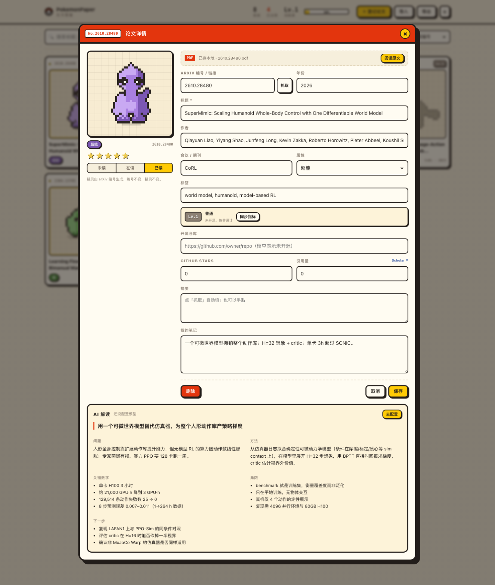

<div align="center">

# PokemonPaper

**把每篇论文变成一只宝可梦。编号就是 arXiv 号，读完点亮。**

[](https://vuejs.org/)
[](https://www.typescriptlang.org/)
[](https://nodejs.org/api/sqlite.html)
[](LICENSE)

[快速开始](#快速开始) · [设计](#三个设计决定) · [目录](#目录结构) · [路线图](#路线图)

</div>


---

## 这是什么

读论文最难的不是读，是**记得自己读过什么**。PokemonPaper 把这件事做成收集游戏：

- 登记一篇论文，它变成一只精灵
- 没读的时候是灰色剪影，读的时候是半彩，读完**点亮**
- 编号就是 arXiv 号——`No.2610.28480` 永远是同一只
- 收集进度、训练家等级、按属性分色

数据全部留在本地 SQLite，不上云。

## 特性

| | |
|---|---|
| 🧬 **确定性精灵** | 32×32 像素，5 种体型（两足/四足/团子/鸟/幽灵），同一 arXiv 号永远生成同一只 |
| 👤 **多用户** | 注册 / 登录，每人一份独立图鉴；密码 scrypt 哈希，会话存 HttpOnly Cookie |
| 📥 **批量导入** | 一行一个 arXiv 编号或链接，最多 50 篇；也支持 BibTeX 和 JSON 备份 |
| 🏷️ **arXiv 即主键** | 粘贴 `https://arxiv.org/pdf/2610.28480` 自动提取编号；重复登记会被拒绝 |
| 🌗 **三态点亮** | 未读剪影 → 在读半彩 → 已读全彩 + 金星 |
| ⚔️ **论文等级** | Lv.1–100，由开源代码、GitHub star、引用量共同决定，分普通/稀有/史诗/传说 |
| 🤖 **AI 速读卡** | 一句话 / 问题 / 方法 / 关键数字 / 局限 / 下一步，OpenAI 兼容接口，Key 存本地 |
| 📄 **PDF 本地化** | 原文存 `data/pdfs/`，库里只记链接和相对路径；没有就从 arXiv 现下 |
| 🔍 **检索** | 标题 / 作者 / 编号 / 标签 / 会议全文搜索，`/` 聚焦 |
| 💾 **可迁移** | 一键导出 JSON，按 arXiv 号合并导入 |

## 三个设计决定

### 1. 编号即身份

arXiv 号自带时间信息（`2610` = 2026 年 10 月），既是业务主键，也是排序依据，也是精灵种子。数据库里 `arxiv` 是 `UNIQUE`，重复登记返回 `409`。

### 2. 精灵必须可复现

```ts
buildSprite(seed: string, type: TypeKey, locked: boolean): SpriteRect[]
```

输入一个字符串，输出 32×32 的矩形数组。只用 FNV-1a hash + mulberry32，**没有 `Math.random()`**。所以 `2610.28480` 在任何机器上都是同一只。

生成器不碰 DOM，换框架只换渲染层。

### 3. 游戏状态是阅读状态

没有签到、没有连击、没有虚拟货币。点亮只有一条路径：你真的把它读完了。未读的剪影和已读的全彩之间，只差一个诚实的点击。

## 账号

- 邮箱 + 密码注册，密码用 `scrypt`（随机 salt）哈希后存库，明文不落盘
- 登录后发一个 `HttpOnly; SameSite=Lax` 的会话 Cookie，30 天有效
- 每个账号的论文、笔记、PDF 完全隔离：所有查询都带 `user_id`
- 同一邮箱连续输错 5 次，锁 60 秒
- 顶栏右侧是训练家头像，点开可以换头像和昵称


> 这是单机自托管服务：没有邮箱验证、没有找回密码、没有 OAuth。放在公网请套 HTTPS 反代。

## 导入论文

三种入口，都在右上角「导入」里：

| 来源 | 用法 |
|---|---|
| arXiv 批量 | 一次贴最多 50 个编号或链接，后端向 `export.arxiv.org` 拉标题、作者、摘要、年份 |
| BibTeX | 粘贴或上传 `.bib`，从 `eprint` / `url` 里提取编号；没有编号的会标黄提示 |
| JSON 备份 | 之前「导出」的文件，按 arXiv 号合并 |

已存在的论文只更新元数据，**不会覆盖**你的笔记、评分和阅读状态。

登记单篇时，arXiv 输入框旁边的「抓取」可以直接补全表单。

## AI 解读

详情页底部是「AI 解读」。点生成，会用摘要产出一张结构化速读卡：

```
一句话 · 问题 · 方法 · 关键数字 · 局限 · 下一步
```



模型走 OpenAI 兼容的 `/chat/completions`。设置里内置了 DeepSeek、OpenAI、Moonshot、智谱、OpenRouter 预设，也可以填任意自建端点。

- **Key 只存在浏览器 localStorage**，请求经本地服务转发，不写数据库、不打日志
- Prompt 明确要求「数字只能来自摘要，没有就留空」，减少编造
- 生成结果存进 SQLite 的 `explain` 字段，可以随时重新生成覆盖

## 论文等级

规则很简单：**不开源就是普通；开源的按 GitHub star 分级。**

| 条件 | 等级 | 段位 |
|---|---|---|
| 没有开源仓库 | Lv.1 | 普通 |
| 开源，0 star | Lv.15 | 普通 |
| 开源，10 star | Lv.34 | 稀有 |
| 开源，100 star | Lv.51 | 史诗 |
| 开源，1k star | Lv.69 | 史诗 |
| 开源，5k star | Lv.82 | 传说 |
| 开源，50k star | Lv.100 | 传说 |

```ts
level = 15 + 85 × log10(1 + stars) / log10(50001)
```

对数刻度的用意：10 star 和 100 star 的差距，应该比 10k 和 20k 的差距更明显。

**引用量不参与等级计算**，只作为参考信息记录在库里。想抓的话在设置里配 Google Scholar 通道（SerpAPI / Serper），否则保持手动填。

**同步 star**：详情页点「同步指标」。没配 `GITHUB_TOKEN` 时 GitHub API 容易触发未认证限流（60 次/时），会自动退回抓取仓库页面里的星数。

## PDF 本地化

- 原文默认放在 `data/pdfs/<arxiv>.pdf`
- 数据库只存 `url`（原始链接）和 `pdf_path`（相对路径）
- 点「下载并阅读」：本地有就直接开，没有就从 `arxiv.org/pdf/<id>` 拉一份存下来
- 服务端支持 `Range` 请求，浏览器 PDF 阅读器可以边下边翻
- `data/pdfs/` 和 `*.db` 都在 `.gitignore` 里

## 技术栈

| 层 | 选型 | 说明 |
|---|---|---|
| 前端 | Vue 3 + TypeScript + Vite + Pinia + Vue Router | 深链接 `/p/<id>` |
| 后端 | Node `http` 单文件服务 | 零运行时依赖 |
| 数据库 | `node:sqlite` | Node 22+ 内置，无原生模块编译 |

生产环境只有一个进程：同一个 Node 服务托管 API 和 `dist/` 静态资源。

## 快速开始

需要 **Node 22+** 和 **pnpm**。

```bash
git clone https://github.com/idejie/PokemonPaper.git
cd PokemonPaper
pnpm install
pnpm dev
```

打开 <http://127.0.0.1:5173>（Vite 会把 `/api` 代理到 8787）。

第一次打开会看到登录页，点「注册」建一个账号。**第一个注册的账号会接管仓库里自带的示例论文**，之后注册的账号从空图鉴开始。

生产模式：

```bash
pnpm build     # 类型检查 + 构建
pnpm start     # http://127.0.0.1:8787
```

> 如果 `pnpm install` 报 `ERR_PNPM_IGNORED_BUILDS: esbuild`，执行一次
> `pnpm approve-builds --all` 再装。

## 数据

- 默认库：`data/pokemonpaper.db`，首次启动自动建表并写入两条示例
- 自定义位置：`POKEMONPAPER_DB=/path/to.db pnpm start`
- 自定义端口：`PORT=9000 pnpm start`
- 可选：`GITHUB_TOKEN=ghp_xxx pnpm start`，把 GitHub API 限额从 60 次/时提到 5000
- 引用量的 SerpAPI / Serper Key 在页面「设置」里填，不用环境变量
- 备份：界面右上角「导出」；恢复用「导入」，按 arXiv 号合并

`data/`、`dist/`、`node_modules/` 都在 `.gitignore` 里，不会进版本库。

## 目录结构

```
server/
  index.mjs          # HTTP API + 静态托管 + SQLite 建表/种子
src/
  core/
    sprite.ts        # 精灵生成器（纯函数，32×32，五种体型）
    typeMap.ts       # 10 种属性定义 + 关键词猜测
    arxiv.ts         # arXiv 编号解析
    level.ts         # 论文等级公式
    api.ts           # API 客户端
    bibtex.ts        # BibTeX 解析（括号平衡 + 字段扫描）
    providers.ts     # 模型厂商预设
    types.ts         # Paper / TypeKey / PaperStatus / Explain
  stores/
    papers.ts        # Pinia store（列表、点亮、PDF、导入导出）
    settings.ts      # 模型配置（localStorage）
    ui.ts            # 弹窗开关
  components/
    SpriteSvg.vue    # 渲染精灵（v-for 矩形，不使用 v-html）
    PaperCard.vue    # 图鉴卡片
    PaperSheet.vue   # 详情 / 登记抽屉
    TrainerBar.vue   # 顶栏：进度、等级、导入导出、设置
    ImportDialog.vue # arXiv / BibTeX / JSON 导入
    SettingsDialog.vue # 模型厂商与 Key
    ToastHost.vue    # 提示
  views/
    DexView.vue      # 图鉴网格 + 搜索筛选
    AuthView.vue     # 登录 / 注册
  core/
    avatar.ts        # 8 个训练家头像（像素拼装）
```

## API

| 方法 | 路径 | 作用 |
|---|---|---|
| `POST` | `/api/auth/register` | 注册（邮箱 + 密码 ≥ 8 位） |
| `POST` | `/api/auth/login` | 登录 |
| `POST` | `/api/auth/logout` | 登出 |
| `GET` | `/api/auth/me` | 当前用户 |
| `PATCH` | `/api/auth/me` | 改昵称 / 头像 |
| `GET` | `/api/papers` | 当前用户的列表 |
| `POST` | `/api/papers` | 新建（`title` 必填，`arxiv` 唯一） |
| `PATCH` | `/api/papers/:id` | 局部更新（状态、笔记、评分…） |
| `DELETE` | `/api/papers/:id` | 删除 |
| `POST` | `/api/arxiv/preview` | 按编号批量抓 arXiv 元数据 |
| `POST` | `/api/papers/:id/pdf` | 确保 PDF 在本地（没有就下载） |
| `GET` | `/api/papers/:id/pdf` | 流式返回 PDF（支持 Range） |
| `POST` | `/api/explain` | 调模型生成速读卡（配置随请求传入） |
| `POST` | `/api/papers/:id/metrics` | 同步 GitHub star 与引用量 |
| `GET` | `/api/export` | 全量导出 JSON |
| `POST` | `/api/import` | 按 arXiv 合并导入 |
| `GET` | `/api/health` | 健康检查 |

## 数据模型

```ts
interface User {
  id: string
  email: string
  name: string
  avatarId: string      // 8 个预设头像之一
  passwordHash: string  // scrypt$salt$hash
  createdAt: string
}

interface Paper {
  id: string
  arxiv: string          // 编号，唯一，同时是精灵种子
  title: string
  authors: string
  venue: string
  year: number | null
  type: TypeKey          // normal/fire/water/grass/electric/psychic/ghost/steel/dark/dragon
  status: 'unread' | 'reading' | 'read'
  rating: number         // 0–5
  tags: string           // 逗号分隔
  notes: string
  abstract: string       // arXiv 摘要
  explain: string        // AI 速读卡的 JSON 字符串
  pdfPath: string        // 相对 data/pdfs/ 的文件名，空表示未下载
  codeUrl: string        // 开源仓库，空表示未开源
  stars: number          // GitHub stars
  citations: number      // 引用量
  metricsAt: string | null
  url: string
  addedAt: string
  readAt: string | null
  userId: string        // 归属账号，所有查询按它隔离
}
```

## 路线图

- [x] 粘贴 arXiv 链接自动抓取标题 / 作者 / 摘要
- [x] 批量导入（arXiv / BibTeX / JSON）
- [x] PDF 本地化与 Range 流式阅读
- [x] AI 速读卡（OpenAI 兼容，预设 DeepSeek 等）
- [x] 论文等级：开源 + star + 引用量
- [ ] 改密码 / 找回密码
- [ ] 指标定时刷新（现在要手点）
- [ ] 批量下载缺失 PDF（后台队列 + 进度）
- [ ] 点亮动效：卡片弹跳 + 经验条增长 + 音效
- [ ] 统计页：按属性、年份、会议分布
- [ ] 解读导出为 Markdown / 独立 HTML 精读页
- [ ] 多人共用（当前是单机单用户）

## 已知限制

- 没有邮箱验证、找回密码、改密码和 OAuth
- 会话存在 SQLite，多实例部署需要共享数据库
- AI 解读质量取决于所选模型；摘要信息不足时它应该留空，但小模型仍可能脑补
- 批量下载 PDF 还没做，目前是一篇一篇点
- star 来自 GitHub，有分钟级延迟；引用量有几天到几周的滞后
- Google Scholar 直连基本被 403，想要 GS 引用数需要 SerpAPI / Serper 的 Key（且不影响等级）
- 等级是影响力代理，不代表论文质量——新论文天然吃亏
- 精灵生成器是模板式的，形状会有重复，但配色和细节组合足够区分
- 未做全文检索，只搜已录入的字段

## License

[MIT](LICENSE) © 2026 idejie
